# TradeTally - Trading Journal & Analytics Platform

[](https://hub.docker.com/r/potentialmidas/tradetally)
[](https://github.com/GeneBO98/tradetally/blob/main/LICENSE)
[](https://github.com/GeneBO98/tradetally/releases)

**Dominate With Data**

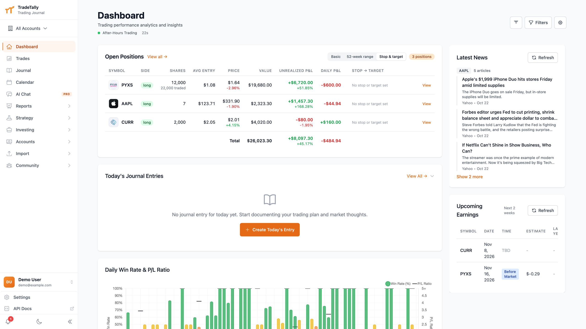

A comprehensive trading journal and analytics platform built with Vue.js frontend and Node.js backend. Track your trades, analyze performance, and gain insights into your trading patterns across multiple brokers.

## Quick Links

- **Live Demo**: [tradetally.io](https://tradetally.io)
- **Documentation**: [docs.tradetally.io](https://docs.tradetally.io)
- **Forum**: [forum.tradetally.io](https://forum.tradetally.io)
- **iOS App**: [Download Here](https://apps.apple.com/us/app/tradetally/id6748022992)
- **Docker Hub**: [potentialmidas/tradetally](https://hub.docker.com/r/potentialmidas/tradetally)

### Demo Account
- **Username**: demo@example.com
- **Password**: DemoUser25

## Major Features

### Trading Journal & Analysis
- **Multi-Broker Support** - Import trades from Lightspeed, Charles Schwab, ThinkorSwim, IBKR, E*TRADE, ProjectX
- **Options & Futures Trading** - Full support for options and futures contracts with specialized analytics
- **Real-time Market Data** - Live stock quotes and unrealized P&L tracking
- **Trade Visualization** - Interactive candlestick charts with entry/exit markers

### Analytics & Insights
- **AI-Powered Analytics** - Personalized trading recommendations through cloud, local, or authenticated Codex/Claude CLI providers
- **Advanced Charts** - Performance analysis by hold time, day of week, sector, and more
- **Behavioral Analytics** - Revenge trading detection and overconfidence tracking (Pro)
- **Health Tracking** - Correlate sleep, heart rate, and other health metrics with trading performance (Pro)

### Markets & Alerts
- **Watchlists** - Track favorite stocks with real-time prices and news (Pro)
- **Price Alerts** - Email and browser notifications for price targets (Pro)
- **News Integration** - Automatic news enrichment for traded symbols
- **Earnings Tracking** - Monitor upcoming earnings for watchlist symbols (Pro)

### Community & Gamification
- **Leaderboards** - Track achievements and compete with peers
- **Public Trades** - Share trades and learn from the community
- **Achievements System** - Unlock badges and track milestones
- **Forum Integration** - Join discussions at [forum.tradetally.io](https://forum.tradetally.io)

### Mobile App
- **iOS App** - Native iOS application available in app store
- Full feature parity with web application
- Optimized mobile trading journal experience
- Required for the health tracking feature

## Deployment Options

### SaaS Platform
Fully hosted solution at [tradetally.io](https://tradetally.io)

### Self-Hosted
Free, open-source deployment with all Pro features included. Perfect for:
- Privacy-conscious users
- Personal or team use
- Complete control over your data
- No subscription fees

**Note**: For full feature access (real-time quotes, advanced charts, sector analysis), a [Finnhub.io Basic plan](https://finnhub.io/pricing) is required. Free tier available with limitations.

**Logo fallbacks**: the logo fallbacks send ticker requests directly from the
browser to Parqet and FMP.

## Technology Stack

**Backend**: Node.js, Express, PostgreSQL
**Frontend**: Vue.js 3, Tailwind CSS, Pinia
**APIs**: Finnhub, Alpha Vantage, configurable AI providers
**Infrastructure**: Docker, Nginx

## Getting Started

For detailed installation and setup instructions, visit the [documentation site](https://docs.tradetally.io).

### Local Development

TradeTally requires Node.js 24.21.0 or newer and uses pnpm for dependency management. Docker and CI use Node.js 24.21.0. If you use nvm, run `nvm install` and `nvm use` from the repository root to select the version pinned in `.nvmrc`.

Install pnpm, then install dependencies from the repository root:

```bash
npm install -g pnpm@10.34.5
pnpm install
pnpm --dir backend run dev
pnpm --dir frontend run dev
```

### Quick Start with Docker

```bash
docker pull potentialmidas/tradetally:latest
docker run -d -p 80:80 potentialmidas/tradetally:latest
```

See the [Docker Deployment Guide](https://docs.tradetally.io/deployment/docker/) for production setup.

## Documentation

Comprehensive documentation is available at [docs.tradetally.io](https://docs.tradetally.io):

- [Installation Guide](https://docs.tradetally.io/getting-started/installation/)
- [Quick Start](https://docs.tradetally.io/getting-started/quick-start/)
- [API Configuration](https://docs.tradetally.io/getting-started/api-keys/)
- [Docker Deployment](https://docs.tradetally.io/deployment/docker/)
- [Importing Trades](https://docs.tradetally.io/usage/importing-trades/)
- [Feature Guides](https://docs.tradetally.io/features/)

## Community & Support

- **Forum**: Join the [TradeTally Discourse](https://forum.tradetally.io) - If you have a TradeTally.io account, you can login with those credentials
- **GitHub Issues**: Report bugs or request features
- **Documentation**: [docs.tradetally.io](https://docs.tradetally.io)
- **iOS TestFlight**: [Join the beta](https://testflight.apple.com/join/11shUY3t)

## Screenshots

**Analytics**

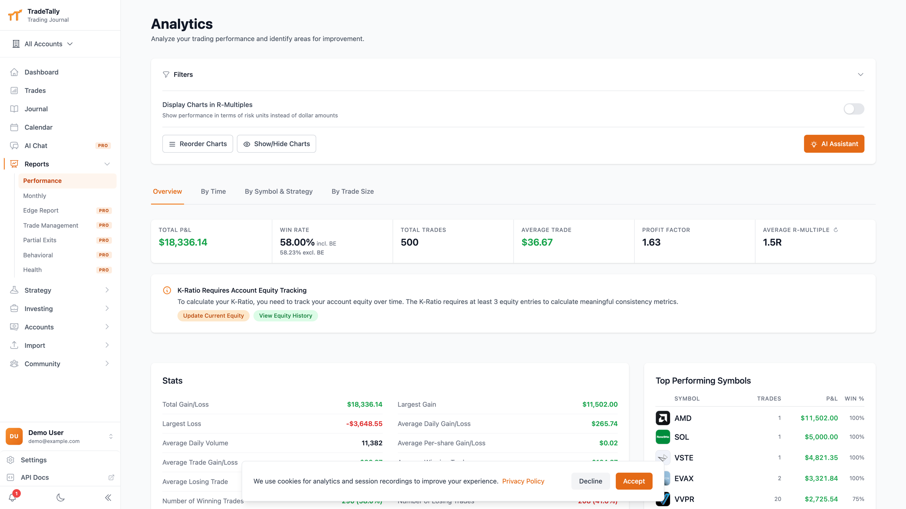

**Trades**

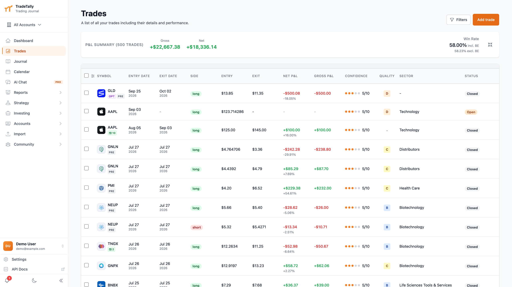

**Trading Calendar**

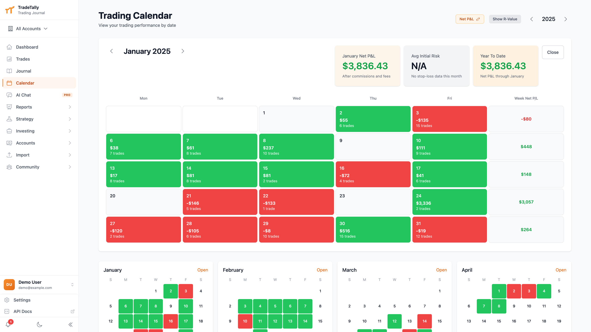

**Trading Journal**

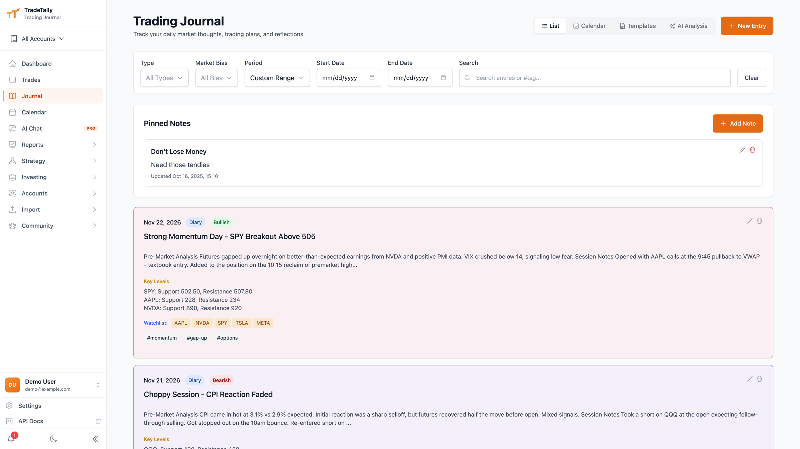

**Trade Management (R-Multiple)**

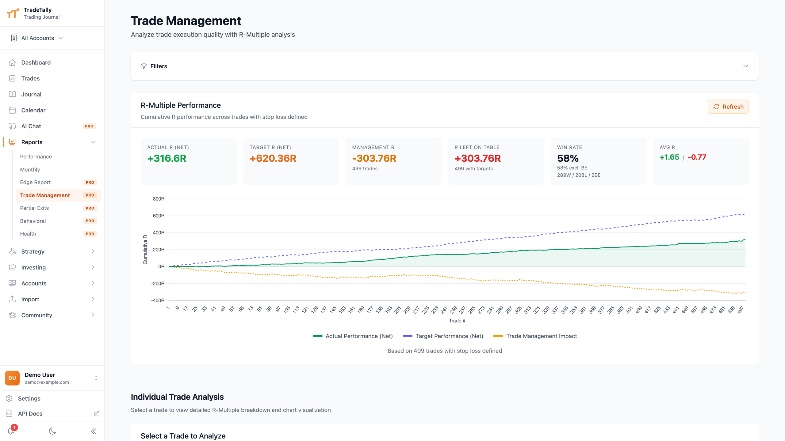

**Behavioral Analytics**

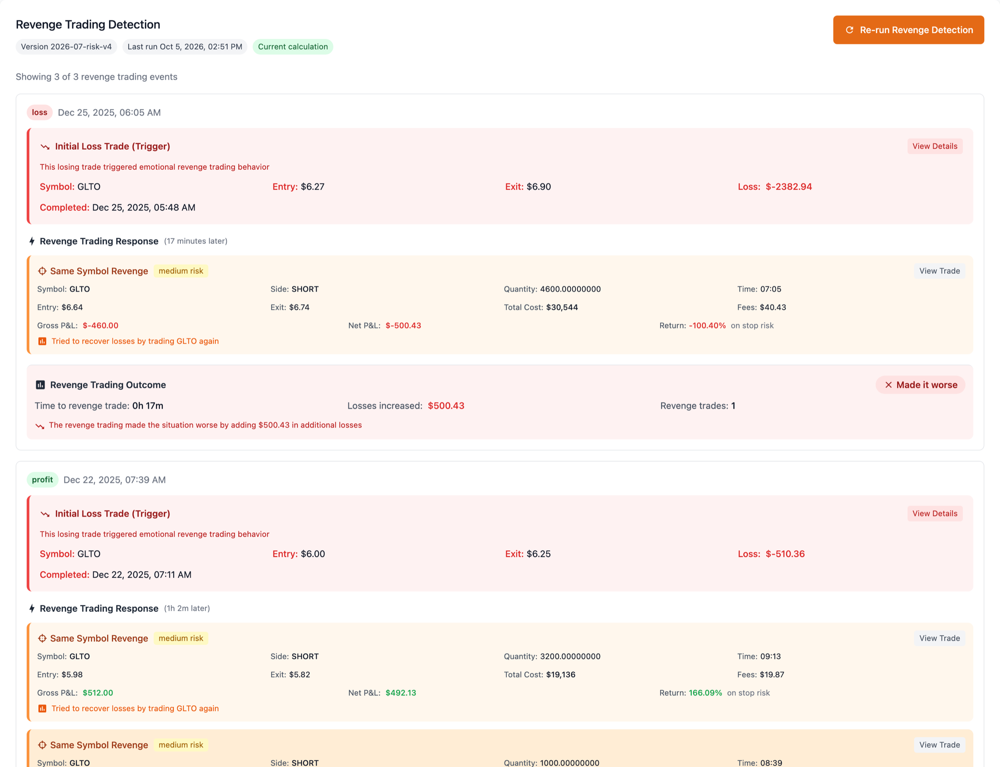
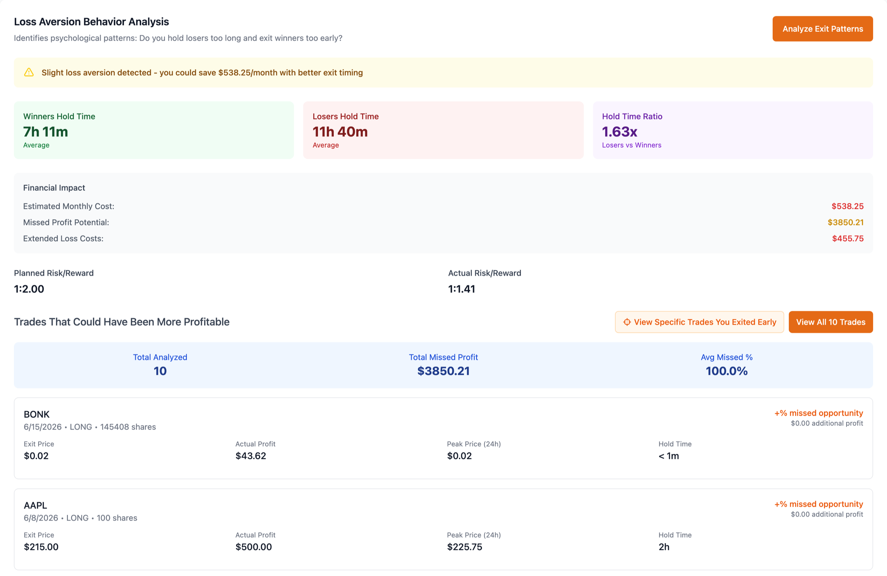
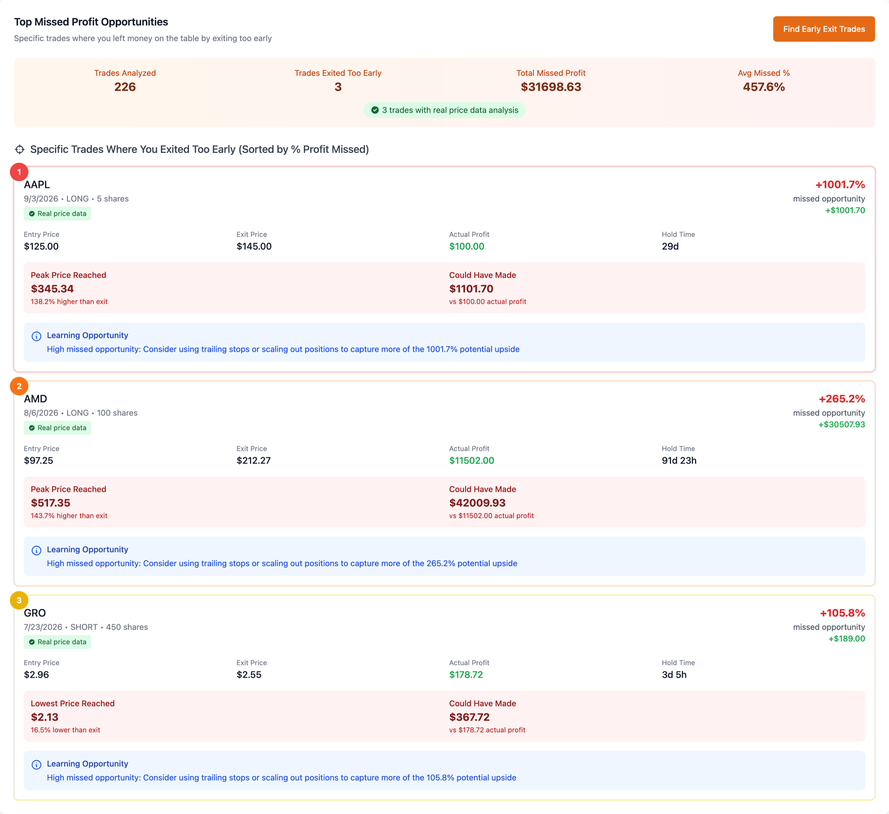

**Leaderboard & Achievements**

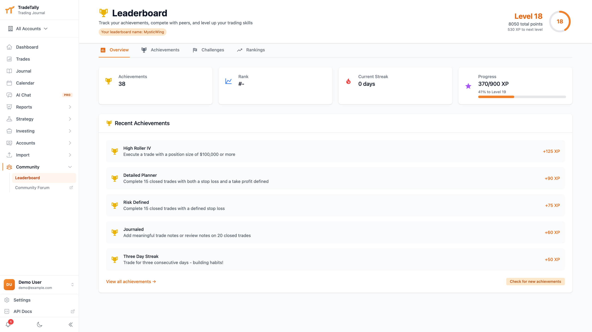
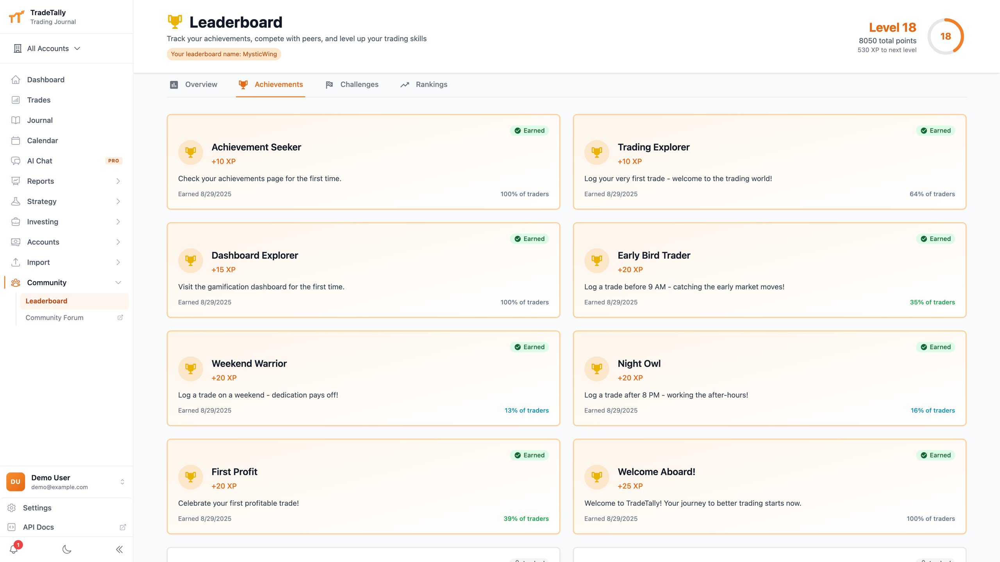

## Star History

[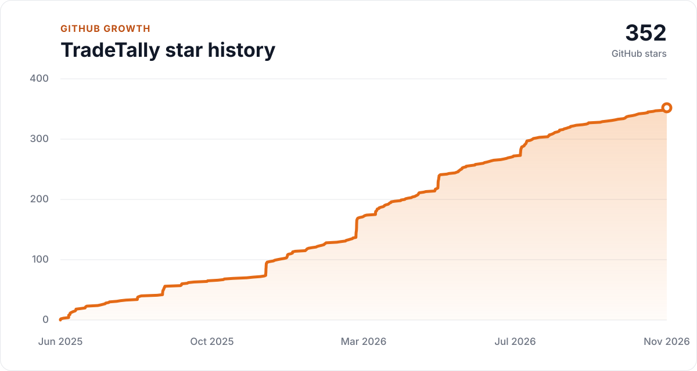](https://github.com/GeneBO98/tradetally)

## License

This project is open source software.

## Support Development

Feel free to [throw me a couple of bucks](https://buymeacoffee.com/BrennonO) if you got some use out of this.
